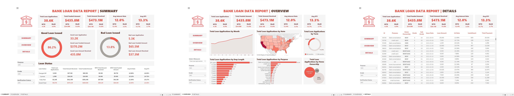

# Bank Loan Portfolio Analysis | SQL & Tableau

A learning project exploring bank loan portfolios through SQL analysis
and interactive Tableau dashboards.

The analysis covers lending activity, funded amounts, payments received,
loan statuses, and borrower segments across three dashboard views:
Summary, Overview, and Details.

> **Project attribution:** This repository uses reference assets from
> [MengLi00Julia’s Bank Loan Data Analysis project](https://github.com/MengLi00Julia/bank-loan-data-analysis).
> The supplied workbook, SQL queries, query results, and screenshots
> originate from that project. Their inclusion here does not imply
> independent authorship.

## Business Questions

- How do loan applications and funded amounts change over time?
- How is lending distributed across regions and loan purposes?
- How do portfolio measures differ across borrower segments?
- What proportion of recorded loans is current, fully paid, or charged off?
- Which patterns warrant further investigation?

## Tools and Technologies

| Tool | Role in the project |
|---|---|
| SQL | Querying loan records and calculating portfolio measures |
| Tableau | Interactive dashboards, calculated metrics, and visual exploration |
| Excel | Reviewing the reference query outputs |
| CSV | Storing the loan dataset |

## Dataset

The original project describes the data as U.S. bank loan records
for 2021.

The dataset supports analysis by dimensions such as:

- Loan issue date and loan status
- Loan purpose and term
- Borrower location
- Employment length
- Home ownership
- Loan grade
- Verification status

**Dataset:** [financial_loan.csv](Assets/financial_loan.csv)

The dataset’s collection methodology and representativeness have not
been independently verified in this repository. Results should be
interpreted within the scope of the supplied records.

## Dashboard Preview

The screenshots below show the reference dashboards included
with the source project.

### Summary Dashboard

Provides a portfolio-level view of loan applications, funded amounts,
payments received, average interest rate, and average debt-to-income
ratio. It also includes monthly comparisons and loan-status summaries.

### Overview Dashboard

Explores lending activity across time, geography, loan terms,
employment length, loan purpose, and home ownership.

### Details Dashboard

Provides a record-level view for examining individual loans and
reviewing the records behind portfolio summaries.

### Dashboard Layout

## Dashboard Interactions

The reference implementation includes:

- Filters for loan purpose, grade, and verification status.
- Interactive selections for exploring portfolio segments.
- A detailed table for inspecting individual loan records.

These features support exploration from portfolio summaries
to individual records.

## Key Measures

| Measure | Analytical purpose |
|---|---|
| Loan applications | Understand lending volume |
| Total funded amount | Measure the value of loans issued |
| Total amount received | Review recorded payments |
| Average interest rate | Compare pricing across the selected records |
| Average debt-to-income ratio | Describe borrower debt burden |
| Loan-status distribution | Compare current, fully paid, and charged-off records |
| Monthly comparisons | Examine changes in lending activity |

Exact aggregation logic should be reviewed in the SQL queries
and Tableau calculations before interpreting results.

## Interpretation and Limitations

### Loan-status labels

The reference implementation groups Fully Paid and Current loans
under “Good Loan.”

Current loans are still outstanding. They should not be interpreted
as completed repayments or guaranteed successful outcomes.

### Charged-off share

The share of charged-off loans describes the observed dataset.
It is not a prediction of future default.

Comparisons across segments may be affected by differences in
loan age, borrower characteristics, and portfolio composition.

### Payments and profitability

The difference between payments received and funded amounts
is not a measure of profit. It does not fully account for timing,
outstanding balances, funding costs, or other expenses.

### Descriptive analysis

Dashboard patterns show associations within the supplied records.
They do not establish causal relationships or independently
justify lending decisions.

## Project Files

| Asset | File |
|---|---|
| Dataset | [Loan records](Assets/financial_loan.csv) |
| SQL analysis | [SQL queries](Assets/BankLoanDataAnalysisProject-SQL%20Queries.sql) |
| Query results | [Excel results](Assets/BankLoanDataAnalysisProject-Query%20Results.xlsx) |
| Tableau workbook | [Tableau workbook](Assets/BankLoanDataAnalysisProject-Tableau%20Visualization.twb) |
| Dashboard screenshots | [Screenshots folder](Assets/Screenshots) |
| Dashboard layout | [Layout image](Assets/dashboard_outline.jpg) |

## How to Explore the Project

1. Review the dashboard screenshots in this README.
2. Open the SQL file to inspect the queries and metric definitions.
3. Select **Code → Download ZIP** to download the repository.
4. Extract the ZIP.
5. Open the `.twb` workbook in a compatible Tableau application.
6. If Tableau reports a missing data connection, reconnect it to:
   `Assets/financial_loan.csv`.
7. Confirm that the fields map correctly and the dashboard views load.

The workbook may retain connection settings from the original
author’s environment. SQL table names and syntax may also need
adjustment for your database.

## Validation Status

The Excel workbook contains query outputs supplied with the
reference project. These are reference results, rather than
independently reproduced validation documented by this repository.

Independent validation should compare SQL and Tableau using
identical populations, filters, and metric definitions.

| Check | Current documentation status |
|---|---|
| Distinct loan count | Independent comparison not yet documented |
| Total funded amount | Independent comparison not yet documented |
| Total received amount | Independent comparison not yet documented |
| Loan-status counts and shares | Independent comparison not yet documented |
| Monthly totals | Independent comparison not yet documented |
| Selected segment totals | Independent comparison not yet documented |

Any differences should be investigated before recording a check
as passed.

## Repository Contributions

The work currently documented in this repository consists of:

- Organizing the reference assets for accessible review.
- Documenting the business questions and dashboard structure.
- Explaining interpretation limitations.
- Outlining checks for independent validation.

The original analysis and dashboard implementation are credited
to the source author. Further implementation changes and independently
verified findings will be documented as they are completed.

## Planned Extensions

- Inspect missing values, duplicate identifiers, and data types.
- Run the SQL queries and reproduce the reference results.
- Compare SQL results with Tableau dashboard values.
- Present Current, Fully Paid, and Charged Off loans separately.
- Document two or three numerical findings and a supported recommendation.

These items describe planned work, not completed achievements.

## References and Attribution

**Original project:**  
[MengLi00Julia — Bank Loan Data Analysis](https://github.com/MengLi00Julia/bank-loan-data-analysis)

**Original author’s interactive dashboard:**  
[Bank Loan Data Analysis on Tableau Public](https://public.tableau.com/app/profile/sylvia.li4170/viz/BankLoanDataAnalysis/SUMMARY)

The linked Tableau Public dashboard belongs to the original author.

Refer to the source repository for its license and reuse terms.
Preserve the original license and applicable copyright notices
alongside reused material.
