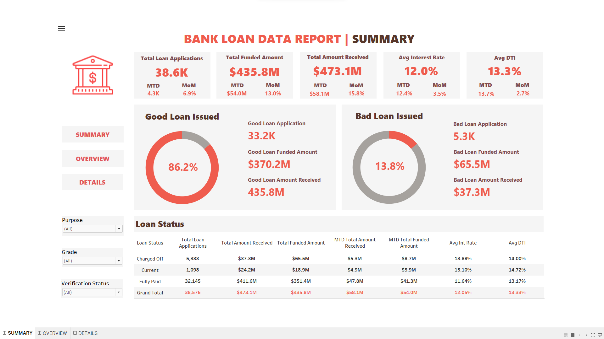
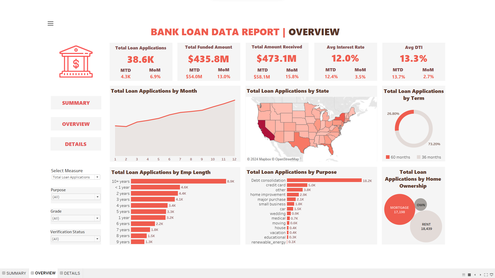
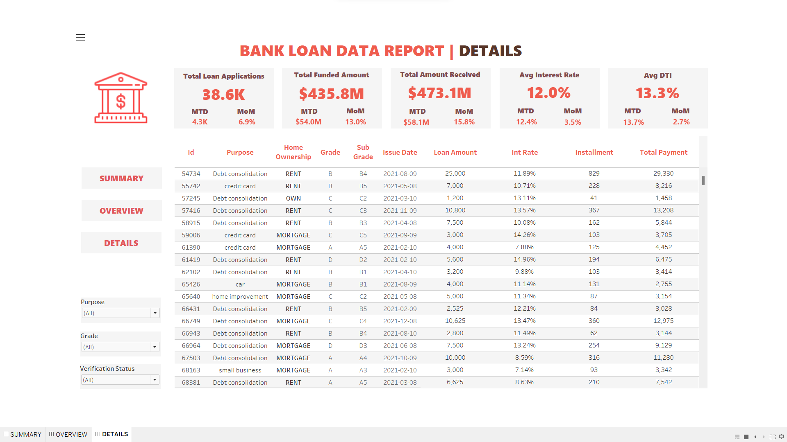

# Bank Loan Portfolio Analysis
### Exploring lending activity and loan performance with SQL and Tableau

## What Is This Project?

This project explores a bank loan dataset to understand how lending
activity varies over time, how funding is distributed across borrower
segments, and how loans are classified by repayment status.

It combines SQL analysis with three Tableau dashboard views:
Summary, Overview, and Details.

The aim is to make portfolio information easier to explore—from
high-level measures such as funded amounts to the individual records
behind those measures.

## Why This Project?

A portfolio can grow in loan volume without showing an equivalent
improvement in repayment outcomes. Looking at applications or funded
amounts alone therefore gives an incomplete picture.

This project brings lending activity and loan-status information
together to explore questions such as:

- Is lending increasing or decreasing over time?
- Which loan purposes account for the largest share of funding?
- How does the portfolio differ across borrower segments?
- How much of the observed portfolio is current, fully paid,
  or charged off?
- Which patterns deserve closer investigation?

As a learning project, it connects SQL-based analysis with interactive
Tableau reporting in a financial-services context.

## Tools Used

| Tool | Purpose |
|---|---|
| SQL | Aggregate loan records and calculate portfolio measures |
| Tableau | Visualize trends, compare segments, and explore records |
| Excel | Review the supplied query outputs |
| CSV | Store the underlying loan data |

## Analytical Approach

### 1. Understand the Data

The analysis uses loan records containing information about loan amounts,
payments received, issue dates, interest rates, borrower characteristics,
and loan status.

The original project describes the dataset as U.S. bank loan data
for 2021.

Key dimensions used for exploration include:

- Loan purpose
- Loan term
- Borrower location
- Employment length
- Home ownership
- Loan grade
- Verification status
- Loan status

Understanding these fields matters because each answers a different
business question. Loan purpose explains the composition of lending,
while loan status describes the recorded repayment position.

### 2. Examine Portfolio Measures with SQL

The SQL component calculates measures used to describe the portfolio,
including:

- Loan application counts
- Total funded amount
- Total amount received
- Average interest rate
- Average debt-to-income ratio
- Loan-status distributions
- Monthly and segment-level summaries

These measures provide a structured basis for exploring the dashboard
and reviewing how its totals are defined.

[View the SQL queries](Assets/BankLoanDataAnalysisProject-SQL%20Queries.sql)

### 3. Organize the Analysis into Three Dashboard Views

The dashboard separates portfolio monitoring, segment exploration,
and record-level inspection into three views.

#### Summary: Understand the Overall Portfolio

The Summary dashboard presents headline measures and loan-status
breakdowns.

It helps the viewer assess the scale of lending and review how the
recorded portfolio is distributed across repayment statuses.

#### Overview: Explore Trends and Segments

The Overview dashboard compares lending activity across time,
geography, loan purpose, loan term, and borrower characteristics.

It helps answer where lending is concentrated and which segments
account for different portions of the portfolio.

#### Details: Inspect the Underlying Records

The Details dashboard provides a loan-level table for examining
individual records behind the aggregate measures.

This view supports closer inspection when a pattern in the summary
or overview requires more context.

### 4. Support Interactive Exploration

Filters for purpose, grade, and verification status allow the viewer
to narrow the analysis to selected groups.

Interactive selections connect the portfolio overview with more
specific segments, while the details table supports record-level
inspection.

## How to Interpret the Analysis

The dashboard supports descriptive analysis. It helps identify patterns
and questions for further investigation, rather than predicting
individual loan outcomes.

Three distinctions are particularly important:

### Current Does Not Mean Fully Repaid

The reference dashboard groups Current and Fully Paid loans under
“Good Loan.”

A current loan is still outstanding. This grouping should not be
interpreted as proof that all those loans will be successfully repaid.

### Payments Received Are Not Profit

Payments received and funded amounts describe different aspects of
the loan portfolio.

Subtracting funded amounts from payments received does not establish
profitability because it does not account fully for timing, remaining
balances, funding costs, or operating expenses.

### Segment Differences Need Context

A higher charged-off share in one segment does not, by itself, explain
why the difference exists.

Loan age, borrower mix, and the number of observations should be
considered before drawing conclusions.

## What This Project Demonstrates

The project illustrates how SQL and Tableau can work together to:

- Translate business questions into measurable portfolio indicators.
- Present headline measures alongside segment-level detail.
- Make loan records accessible through interactive reporting.
- Explain the limitations of financial metrics and status labels.

Independent SQL-to-Tableau reconciliation and personal implementation
changes are not yet documented in this repository.

## Project Files

| Resource | Link |
|---|---|
| Dataset | [financial_loan.csv](Assets/financial_loan.csv) |
| SQL queries | [Portfolio analysis queries](Assets/BankLoanDataAnalysisProject-SQL%20Queries.sql) |
| Reference query results | [Excel workbook](Assets/BankLoanDataAnalysisProject-Query%20Results.xlsx) |
| Tableau workbook | [Open or download the workbook](Assets/BankLoanDataAnalysisProject-Tableau%20Visualization.twb) |
| Screenshots | [Dashboard images](Assets/Screenshots) |

## How to Explore the Project

1. Review the dashboard screenshots above.
2. Open the SQL file to inspect the queries.
3. Download the repository using **Code → Download ZIP**.
4. Extract the downloaded folder.
5. Open the Tableau workbook in a compatible Tableau application.
6. If the original data connection is unavailable, reconnect the
   workbook to `Assets/financial_loan.csv`.
7. Explore the dashboard filters and record-level details.

Database table names and SQL syntax may need adjustment for the
environment in which the queries are run.
